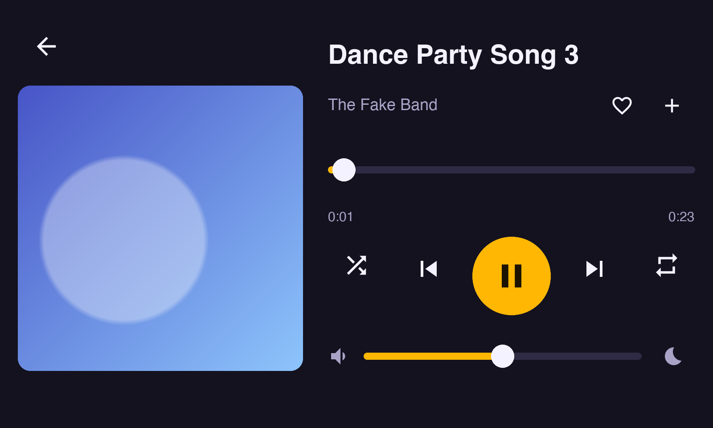
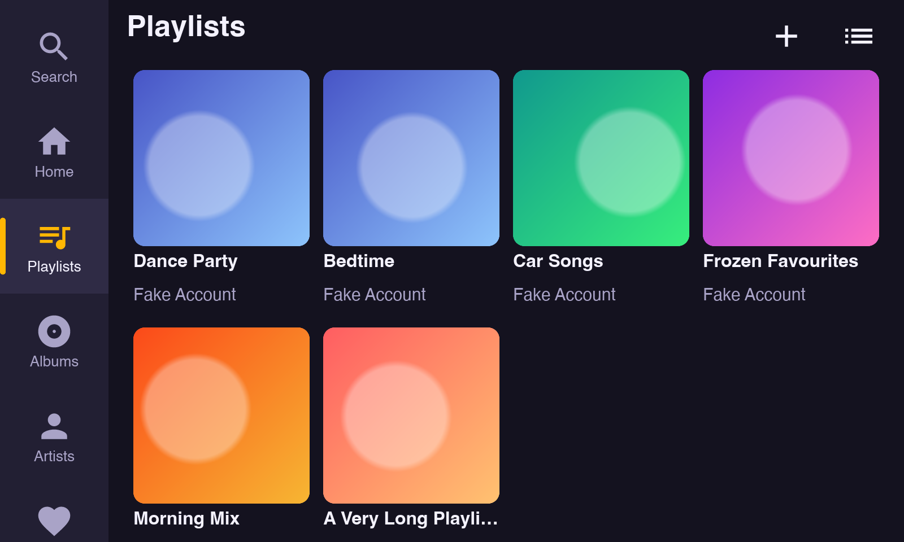
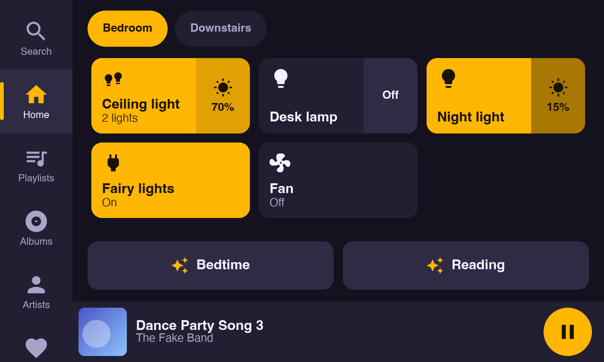
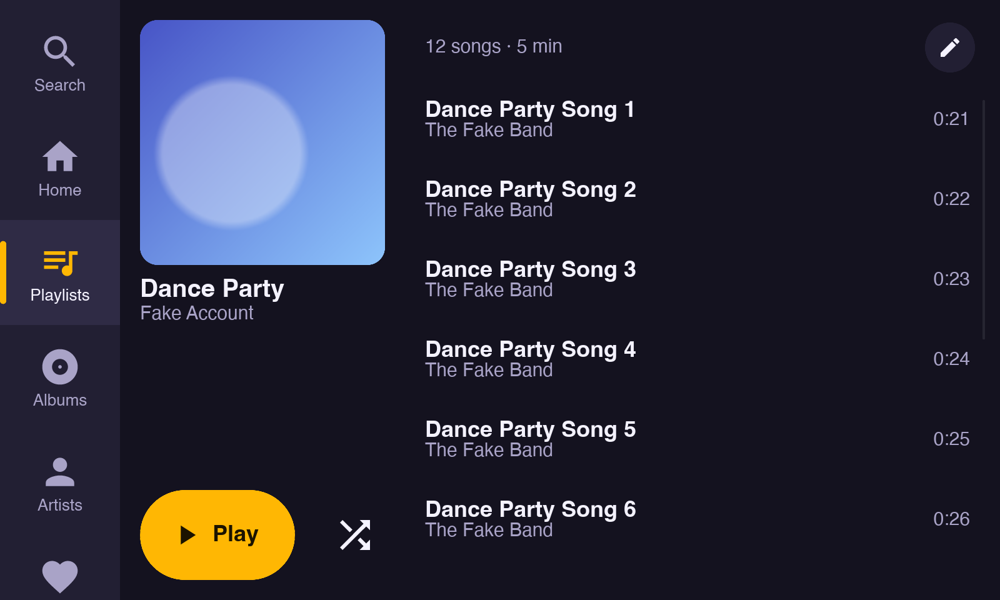

# Ziggy Player

A music player with a touchscreen, built on a Raspberry Pi. It plays your Spotify playlists, albums and liked songs, and music files kept on its SD card. It does nothing else: no apps, no feeds, no ads.

- **Spotify:** your library, search, playlist editing and hearting songs, with recently played kept on the player.
- **My music:** MP3, M4A/AAC and FLAC files on the player's SD card, alongside Spotify or without it. See [My music](#my-music).
- **Speakers:** the headphone jack, a Bluetooth speaker, or a Sonos room.
- **AirPlay:** the player can be an AirPlay speaker for an iPhone, iPad or Mac.
- **Audiobooks:** browse an [Audiobookshelf](https://www.audiobookshelf.org/) server at home.
- **Home Assistant:** switch and dim lights, turn switches and fans on and off, and run scenes from a Home screen.
- **Voice control:** say "ziggy, play Road Trip", "ziggy, heart this" or, with Home Assistant, "ziggy, turn off the lights". Voice is optional and needs a USB microphone.
- **Bedtime:** a sleep timer that fades the music out, and a screen that dims and turns itself off.

| | |
|---|---|
|  |  |
|  |  |

The screenshots use a made-up library. To make them again, run `cargo run -p ziggy-player --example screenshots -- docs/screenshots`.

## What you need

- A Raspberry Pi 3 A+ or newer, a power supply and a microSD card (16 GB is plenty; 8 GB is the least).
- A 7" DSI touchscreen: the official Raspberry Pi one, or one like Hosyond's 7" DSI display, which carries the Pi on its back.
- Speakers or headphones: the Pi's headphone jack, a Bluetooth speaker, or a Sonos system.
- A Spotify Premium account for each person, for Spotify. A player can also play only music on its SD card, with no Spotify account.
- A Mac or Linux computer to run setup from, on the same Wi-Fi as the Pi.
- Optional: a USB microphone for voice control, and a Google Cloud project or Gemini API key for it.

## Get started

### 1. Install the setup tool

On your computer, run:

```bash
curl -fsSL https://raw.githubusercontent.com/mberg/ziggy/main/install.sh | sh
```

This installs `ziggy` into `~/.local/bin`. If the installer says that folder isn't on your PATH, follow the line it prints.

### 2. Prepare the SD card

1. Install [Raspberry Pi Imager](https://www.raspberrypi.com/software/).
2. Choose your Pi model, then **Raspberry Pi OS Lite (64-bit)**.
3. Open the settings (the gear, or "Edit settings") and set:
   - a hostname, such as `ziggy-kitchen`;
   - a username and password;
   - your Wi-Fi network;
   - **SSH**, using your public key. Without a key, setup can't reach the Pi.
4. Write the card, put it in the Pi, connect the display, and power the Pi on.

### 3. Run setup

```bash
ziggy setup
```

Setup asks one thing at a time:

1. **The Pi's address**, such as `ziggy-kitchen.local`. It checks it can connect.
2. **The player's name.** Spotify shows it when you pick where to play.
3. **Spotify.** It asks whether to use Spotify on this player. Answer no for a player that plays only music on its SD card, and setup skips the rest of this step.
   - The first time, it asks for a Spotify Soloist API key, which plays the music on the Pi. Make one at the [Spotify developer dashboard](https://developer.spotify.com/dashboard) by choosing "Spotify Soloist API Key". Setup keeps it on your computer for every player after that.
   - It also walks you through creating a free Spotify developer app, which loads the library. One app serves every player and every person.
   - A browser opens to sign in for the library.
   - Then sign in for playback: on a phone or computer on the same Wi-Fi, open the Spotify app as the person the player is for, tap the devices button and pick the player. The Spotify website can't find a new player, so use the app.
4. **Extras.** An Audiobookshelf address, My music (music files on the card) and whether to share its folder on your network, and voice control, all optional.
5. **Install.** It prepares the Pi, installs the newest player and copies your settings across. The first time takes a few minutes and restarts the Pi.

When setup finishes, the player is on the screen.

### 4. On the touchscreen

- **Settings → Speaker** pairs a Bluetooth speaker or picks a Sonos room. Put a Bluetooth speaker in pairing mode first.
- **Settings → My music** turns My music on or off, and its **Shared folder** shares the music folder on your network. See [My music](#my-music).
- **Settings → AirPlay** turns the AirPlay speaker on or off. See [AirPlay](#airplay).
- **Settings → Audiobooks** signs in to Audiobookshelf. Each player can use its own Audiobookshelf user.
- **Settings → Colours** and **Sleep timer** take effect at once.
- The top of **Settings** shows the Wi-Fi network, its signal and the Pi's temperature.
- **Settings → Connection → Reconnect** rejoins the Wi-Fi and Spotify, for when music or the library stops loading.
- **Settings → Power → Turn off** shuts the Pi down safely before you unplug it.

## Looking after a player

Run these from your computer:

| Command | What it does |
|---|---|
| `ziggy config ziggy-kitchen.local` | Change settings from a menu: the name, volume, screen timeouts, Audiobookshelf, Home Assistant, voice, My music and the shared music folder. Saving restarts the player. |
| `ziggy update ziggy-kitchen.local` | Install the newest player and restart it. |
| `ziggy status ziggy-kitchen.local` | Check the player is running, and which version it is. |
| `ziggy logs ziggy-kitchen.local` | Watch what the player is doing, for when something's wrong. |
| `ziggy music add ~/Music/Abba ziggy-kitchen.local` | Copy music folders or files onto the player. `ziggy music list`, `remove` and `space` show what's there, delete a folder and show the room left. See [My music](#my-music). |
| `ziggy signin ziggy-kitchen.local` | Sign a different Spotify account in on that player: the library in a browser, then playback by picking the player in the Spotify app. |

`ziggy setup` can be run again on the same Pi at any time. It keeps the Spotify sign-in unless you choose to sign in again.

Choices made on the touchscreen take priority over the config. For example, a name changed in Settings stays until you change it there again.

## How it starts

The player runs as a system service, so it starts by itself whenever the Pi powers on. If it ever stops, it restarts. There's no desktop: the Pi boots straight into the player.

Setup trims the boot:
- there's no splash screen or boot delay, and no console login;
- background package jobs are off;
- **the player doesn't wait for Wi-Fi.** It shows your saved library straight away and connects to Spotify once the network is up.

If the Wi-Fi drops and stays down for 3 minutes, the player rejoins it by itself and reloads the library once it's back. After a power cut it keeps trying the saved Spotify sign-in until Spotify answers.

## Voice control

Voice needs a USB microphone and access to Google's Gemini. Plug the microphone into the Pi before running setup, so setup can make it the Pi's recording device. If you add one later, run `ziggy setup` again. Setup offers two ways to reach Gemini:

- **A Google Cloud service account key file (Vertex AI).** Use this if you have Google Cloud credits. In a Google Cloud project, turn on Vertex AI and create a service account with the "Vertex AI User" role. Then create a JSON key for it and give setup the file.
- **A Gemini API key** from [Google AI Studio](https://aistudio.google.com/).

How it works:
1. **Wake word.** "Ziggy" is heard on the Pi itself. No audio leaves the Pi until then.
2. **Gemini.** The request is sent to Gemini, which picks one action.
3. **Action.** The player carries it out exactly as if you'd tapped it.

The microphone button in Search does the same without the wake word.

You can ask to play anything in your library or on Spotify, pause, skip, change the volume, set the sleep timer, heart the song, save its album, or add it to one of your playlists.

To change the wake word or its sensitivity, run `ziggy config`.

## My music

A player can also play music files kept on its own SD card: MP3, M4A/AAC and FLAC. They show under My music in the rail as albums, read from the files' tags; an album leads to its artist's other albums. On a player with Spotify, My music is off until you turn it on: answer yes in `ziggy setup`, turn it on in Settings → My music on the touchscreen, or use `ziggy config`. A player without Spotify always has it. Playing from My music pauses Spotify, and playing from Spotify stops My music, the same as AirPlay. A 16 GB card has room for about 2,000 songs.

There are three ways to get music onto the player. All three copy into the same folder on the Pi, `/var/lib/ziggy-music`. Any folder layout works; `Artist/Album/01 Song.mp3` is the tidiest. A player set up before My music gets the folder with `ziggy update`.

- **The `ziggy music` command**, from your computer:

  ```bash
  ziggy music add ~/Music/Abba ~/Music/Moana ziggy-kitchen.local
  ziggy music list ziggy-kitchen.local
  ziggy music remove "Abba/Gold" ziggy-kitchen.local
  ziggy music space ziggy-kitchen.local
  ```

  `add` copies each folder by its name, with its layout, and skips files already on the player. It checks the free space first. It copies music and covers (`cover.jpg`, `folder.jpg` or `front.jpg`) and lists the files it skipped. It needs `rsync`, which Macs and most Linux computers have.
- **The shared folder.** The player can share its music folder on your network, as **Music**. On a Mac it shows in Finder under Network, by the player's hostname, such as `ziggy-kitchen`. On Windows, type `\\ziggy-kitchen.local\Music` in File Explorer; Windows 11 usually refuses a shared folder without a password, so set one (below). Drag music in. It's off by default, because anyone on your Wi-Fi can add or delete music while it's on. Turn it on in Settings → My music → Shared folder, or with `ziggy config`. To make it ask for a password, run `ziggy music share-password ziggy-kitchen.local`; then connect as `ziggy` with that password.
- **An agent skill.** `skills/ziggy-music` tells an agent such as Claude Code how to copy the music you name with `ziggy music`. To install it for Claude Code, copy the folder into `~/.claude/skills`:

  ```bash
  cp -r skills/ziggy-music ~/.claude/skills/
  ```

  Then ask, for example, "put the Abba albums on ziggy-kitchen".

**Players without Spotify.** Answer no to Spotify in `ziggy setup`, and the player plays only music on its card. It needs no Spotify account. To add Spotify later, run `ziggy setup` again and answer yes; the music on the card stays.

A Sonos room can't play music from the card yet. With Sonos as the speaker, My music plays through the player's own speaker.

## Home Assistant

A player can switch and dim Home Assistant lights, turn switches and fans on and off, and run scenes and scripts. They show on a Home screen, second in the rail. Each player has its own pages of controls.

1. **Make a user for Ziggy.** In Home Assistant, go to Settings → People and add a person called "Ziggy". Turn on "Allow person to login" and leave "Administrator" off.
2. **Create a token.** Sign in to Home Assistant as that user. Open its profile, then the Security tab, and create a long-lived access token. Copy it; Home Assistant shows it only once.
3. **Run `ziggy config ziggy-kitchen.local`** and pick Home Assistant. It offers the address it finds on your network, then asks for the token and copies it to the player. Use a local `http://` address with a name, such as `http://bergmini.local:8123`, rather than an IP address: a new router hands out new IP addresses, but the name stays the same.
4. **Add pages** to `/etc/ziggy/config.toml` on the Pi (`ssh ziggy-kitchen.local`, then `sudo nano /etc/ziggy/config.toml`). Each page has a name and a list of controls:

   ```toml
   [home_assistant]
   url = "http://bergmini.local:8123"

   [[home_assistant.page]]
   name = "Living room"
   controls = ["light.ceiling", { entity = "light.desk", name = "Desk lamp" }, "switch.fairy_lights", "scene.evening"]

   [[home_assistant.page]]
   name = "Downstairs"
   controls = ["light.kitchen", "light.porch", "fan.office", "script.good_night"]
   ```

   A control is an entity ID, as shown in Home Assistant under Settings → Devices & services → Entities. To show a different name on its tile, write `{ entity = "…", name = "…" }`. Lights, switches and fans become tiles. Scenes and scripts become buttons along the bottom. Then restart the player with `sudo systemctl restart ziggy-player`. Running `ziggy config` later rewrites this file, so comments you add are dropped; your pages are kept.

Home stays hidden until the config has at least one page. `ziggy config` and `ziggy setup` keep the pages you've written. The only Home Assistant data the Pi stores is the token; the states of lights and switches come live from Home Assistant.

With voice control on, the same controls answer to voice: "ziggy, turn off the mud room", "ziggy, dim MR to 30", "ziggy, bedroom nightlight". Voice reaches only the controls on that player's pages.

## AirPlay

A player can also be an AirPlay speaker, for an iPhone, iPad or Mac on the same Wi-Fi. Turn it on in Settings → AirPlay. It shows up in the AirPlay list under the player's name, and plays through the player's own speaker. It doesn't play to a Sonos room.

While something plays over AirPlay, Now Playing shows its song, cover and progress, marked "AirPlay". Play, pause, skip and volume control the phone; seeking, shuffle and repeat don't apply. Spotify pauses when AirPlay starts. You can still browse, and Home still works. Playing anything from Spotify on the player, or picking the player in a Spotify app, ends AirPlay. The sleep timer pauses AirPlay too.

`ziggy setup` and `ziggy update` install shairport-sync, the AirPlay receiver. It's AirPlay 1, which every iPhone and Mac can play to. It doesn't group with other AirPlay 2 speakers. Nothing is saved on the SD card: the receiver's settings and covers are kept in memory.

## Troubleshooting

- **Setup can't connect to the Pi.** Check that `ssh ziggy-kitchen.local` works. The hostname and SSH key must match what you set in Imager. If your username on the Pi differs from your computer's, use `pi@ziggy-kitchen.local`.
- **Setup says sudo asks for a password.** Newer Raspberry Pi OS images do this for the Imager user. Run the one-line command setup prints, which asks for the Pi's password once, then continue.
- **Spotify says it's limiting requests.** Spotify sometimes rate-limits a developer app for up to a day. Setup saves the sign-in and carries on. The library loads once the limit ends, and playing music isn't affected.
- **Spotify says some requests were refused.** Add the account's email under "User Management" in the Spotify developer app, then run `ziggy signin`.
- **Music or the library stops loading.** Tap Settings → Connection → Reconnect.
- **The screen is blank.** Run `ziggy status`, then `ziggy logs` to see why.

## For developers

The code:
- `crates/ziggy-player` is the touchscreen app, in Rust with [Slint](https://slint.dev). It plays through [Spotify Soloist](https://developer.spotify.com/), which runs on the Pi, and uses the Spotify Web API for the library.
- `crates/ziggy-setup` builds the `ziggy` tool.
- `deploy/` holds what's installed on the Pi.
- `docs/` holds the design specs and the [manual test checklists](docs/testing.md).

To build and test, you need Rust 1.97.1 (`asdf install` reads `.tool-versions`) and Xcode command line tools on a Mac:

```bash
cargo test --workspace
cargo run -p ziggy-player -- --fake      # the UI with a made-up library, no Spotify needed
```

Docker Desktop is needed only to build the Pi player:

```bash
scripts/build-pi.sh                                                   # builds target/pi/release/ziggy-player
cargo run -p ziggy-setup --bin ziggy -- update ziggy-kitchen.local \
    --player-binary target/pi/release/ziggy-player                    # tries it on a Pi
```

**Releasing.** Raise `version` in `Cargo.toml`, then push a tag:

```bash
git tag v0.2.0 && git push origin v0.2.0
```

The release workflow builds the Pi player and `ziggy` for Macs and Linux, then publishes them as a GitHub release. `install.sh`, `ziggy setup` and `ziggy update` all use the newest release.
